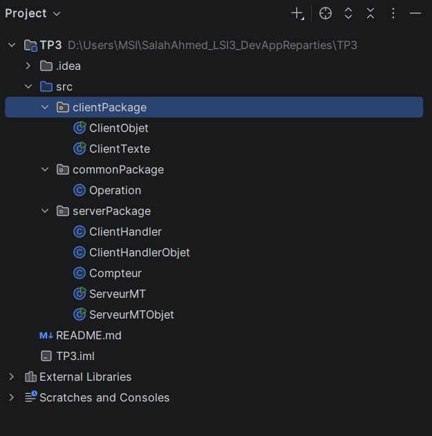
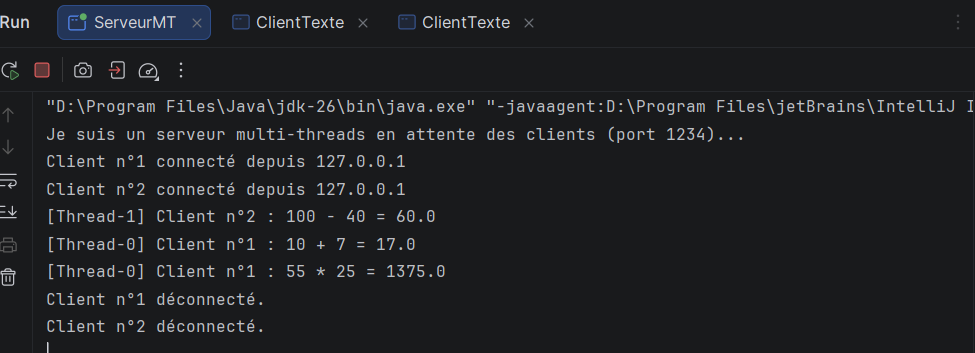
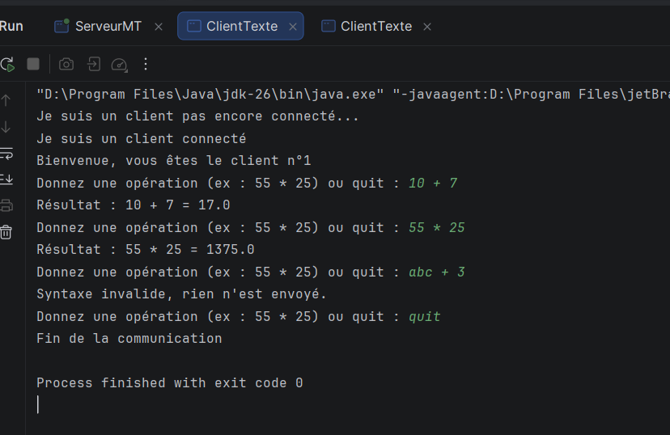
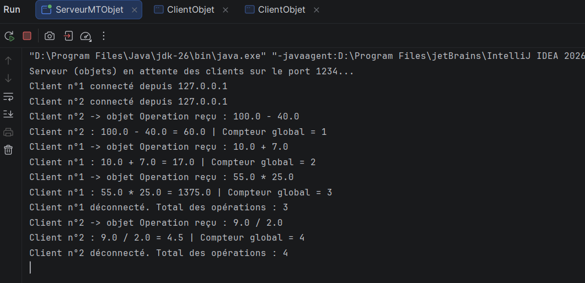
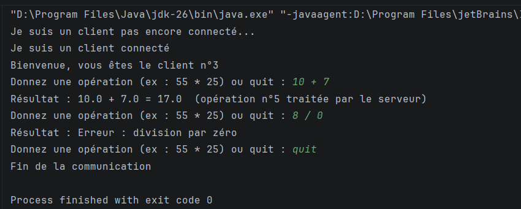
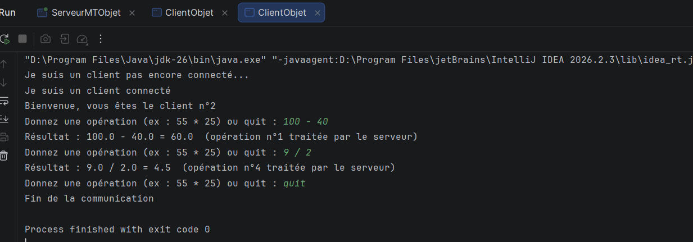

# TP3-DAR2026 — Serveur multi-threads (Sockets TCP)

**Matière :** Développement d'applications réparties — LSI 3
**Faculté des Sciences de Sfax** — Année universitaire 2026–2027
**Étudiant :** Salah Ahmed

> ⚠️ **À supprimer avant le rendu :** chaque bloc 📸 indique **quoi capturer**. Collez votre capture sur la ligne vide juste en dessous du bloc (sur GitHub : ✏️ Edit → Ctrl+V), puis supprimez le bloc 📸.
>
> **Avant les captures :** dans IntelliJ, pour lancer le même client 2 fois, ouvrez *Run → Edit Configurations → Modify options* et cochez **Allow multiple instances**.

---

## Structure du projet

```
TP3/src
├── commonPackage
│   └── Operation.java            (objet Serializable – activité 3-2)
├── clientPackage
│   ├── ClientTexte.java          (client – activité 3-1)
│   └── ClientObjet.java          (client – activité 3-2)
└── serverPackage
    ├── ServeurMT.java            (serveur multi-threads – 3-1)
    ├── ClientHandler.java        (thread d'un client – 3-1)
    ├── ServeurMTObjet.java       (serveur multi-threads – 3-2)
    ├── ClientHandlerObjet.java   (thread d'un client – 3-2)
    └── Compteur.java             (compteur global synchronisé – 3-2)
```

> 📸 **CAPTURE 1 — Arborescence du projet**



---

## Activité 3-1 : Serveur multi-threads (échange de texte)

Le serveur `ServeurMT` accepte les clients en boucle. Pour chaque connexion, il donne au client un **numéro d'ordre** et lance un **thread dédié** (`ClientHandler`). Il peut donc servir plusieurs clients en même temps. Chaque client envoie des opérations sous forme de texte (ex : `55 * 25`) et reçoit le résultat.

**Exécution :** lancer `ServeurMT`, puis lancer `ClientTexte` **deux fois**.

### Serveur : plusieurs clients en parallèle

> 📸 **CAPTURE 2 — Console du serveur `ServeurMT`**
> 1. Lancez `ServeurMT`.
> 2. Lancez `ClientTexte` (client 1) et tapez `10 + 7`.
> 3. Lancez un 2ᵉ `ClientTexte` (client 2) et tapez `100 - 40`.
> 4. Revenez au client 1 et tapez `55 * 25`, puis `quit`. Dans le client 2, tapez `quit`.
> 5. Capturez la console **ServeurMT**. Elle doit afficher :
> ```

> ```


Chaque client a son propre numéro et son propre thread (`Thread-0`, `Thread-1`). Les opérations des deux clients sont traitées en parallèle et indépendamment.

### Client : réception du numéro et des résultats


> ```


Le client reçoit son numéro d'ordre envoyé par le serveur. Une opération mal écrite est refusée côté client et n'est pas envoyée.

---

## Activité 3-2 : Serveur multi-threads avec objets et compteur global

Le client envoie maintenant un objet **`Operation`** (`Serializable`) avec `ObjectOutputStream`. Le thread du serveur (`ClientHandlerObjet`) le reçoit, calcule, écrit la réponse dans l'objet et le renvoie.

Le serveur tient aussi un **compteur global** du nombre total d'opérations calculées, tous clients confondus. Ce compteur est une **ressource partagée** entre les threads : il est protégé par des méthodes `synchronized` dans la classe `Compteur`, pour que deux threads ne le modifient jamais en même temps.

```java
public static synchronized int incrementer() {
    nbOperations++;
    return nbOperations;
}
```

**Exécution :** lancer `ServeurMTObjet`, puis lancer `ClientObjet` **deux fois**.

### Serveur : objets reçus et compteur global partagé

> 📸 **CAPTURE 4 — Console du serveur `ServeurMTObjet`**
> 1. Arrêtez `ServeurMT` s'il tourne encore (bouton rouge ■), sinon le port 1234 est occupé.
> 2. Lancez `ServeurMTObjet`.
> 3. Client 1 : tapez `10 + 7`.
> 4. Client 2 : tapez `100 - 40`.
> 5. Client 1 : tapez `55 * 25`, puis `quit`.
> 6. Client 2 : tapez `9 / 2`, puis `quit`.



Le compteur est le même pour tous les clients : il compte toutes les opérations du serveur. Grâce à `synchronized`, il augmente toujours de 1, sans valeur perdue ni doublon.

### Clients : résultats reçus dans l'objet

> 📸 **CAPTURE 5 — Consoles des 2 clients `ClientObjet`**
> - Capturez les **deux onglets clients** de la même exécution (côte à côte, ou deux images l'une sous l'autre).
> - Client 1 : tapez aussi `8 / 0` avant `quit` pour montrer l'erreur.
> - On doit voir dans le **client 1** :
> ```

> ```
> - Et dans le **client 2** :
> ```

> ```


Chaque client reçoit l'objet `Operation` complété par le serveur. Les numéros d'opération (5 pour le client 1 et 1, 4 pour le client 2) montrent que le compteur est partagé entre les clients.

---

## Conclusion

Le thread principal du serveur ne fait qu'accepter les connexions, et chaque client est traité dans son propre thread : le serveur sert donc plusieurs clients en même temps. Dans l'activité 3-2, l'échange par objets rend le code plus clair. Le compteur global, partagé par tous les threads, est protégé par `synchronized` pour rester cohérent.
